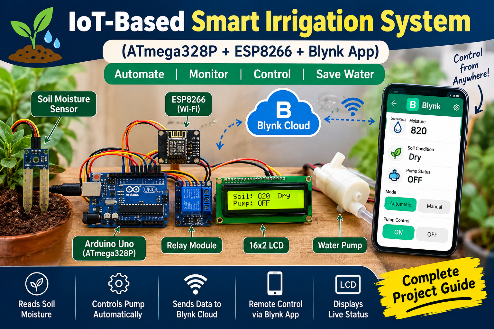

# IoT-Based Smart Irrigation System 🌱

<p align="center">
  
</p>

<p align="center">
  <b>Automated Irrigation | Soil Moisture Monitoring | Wi-Fi Connectivity | Remote Pump Control</b>
</p>

## 📌 Project Overview

The IoT-Based Smart Irrigation System is an embedded systems project designed to automate plant watering based on soil moisture levels.

The system uses an ATmega328P-based Arduino Uno to read analog soil moisture sensor data, process the readings, display the soil condition on a 16×2 LCD, and control a water pump through a relay module.

An ESP8266 Wi-Fi module provides internet connectivity for sending sensor readings and pump status to Blynk IoT Cloud. The planned cloud integration also supports remote pump control through the Blynk mobile application.

The project combines embedded C/C++ programming, sensor interfacing, GPIO control, UART communication, and IoT connectivity.

## 🎯 Project Objectives

* Monitor soil moisture using an analog sensor.
* Automate water pump operation based on predefined moisture thresholds.
* Display sensor readings and soil conditions on a 16×2 LCD.
* Interface an ESP8266 Wi-Fi module with the Arduino Uno.
* Send sensor readings and pump status to Blynk IoT Cloud.
* Support remote pump control and automatic/manual operating modes.

## 🛠️ Hardware Requirements

| Component                   | Purpose                                             |
| --------------------------- | --------------------------------------------------- |
| Arduino Uno (ATmega328P)    | Main controller for sensor reading and pump control |
| ESP8266 ESP-01              | Wi-Fi connectivity                                  |
| Soil Moisture Sensor        | Measures soil moisture levels                       |
| 16×2 LCD                    | Displays sensor readings and soil condition         |
| Relay Module                | Switches the water pump                             |
| Water Pump                  | Supplies water for irrigation                       |
| Regulated 3.3V Power Supply | Powers the ESP8266                                  |
| Jumper Wires                | Electrical connections                              |
| Suitable Pump Power Supply  | Powers the water pump                               |

## 💻 Software and Technologies

* Embedded C/C++ for Arduino
* Arduino IDE
* ATmega328P Microcontroller
* ESP8266 Wi-Fi Module
* UART Serial Communication
* Analog-to-Digital Conversion (ADC)
* GPIO Interfacing
* Blynk IoT Platform
* AT Commands for ESP8266 communication

## 🔌 Pin Connections

### Arduino Uno Connections

| Component            | Component Pin | Arduino Pin                                    |
| -------------------- | ------------- | ---------------------------------------------- |
| Soil Moisture Sensor | AO            | A0                                             |
| LCD                  | RS            | D13                                            |
| LCD                  | EN            | D12                                            |
| LCD                  | D4            | D8                                             |
| LCD                  | D5            | D9                                             |
| LCD                  | D6            | D10                                            |
| LCD                  | D7            | D11                                            |
| Relay Module         | IN            | D7                                             |
| ESP8266              | TX            | D2 (SoftwareSerial RX)                         |
| ESP8266              | RX            | D3 (SoftwareSerial TX, through level shifting) |

### ESP8266 Power Connections

| ESP8266 Pin | Connection                                      |
| ----------- | ----------------------------------------------- |
| VCC         | Regulated 3.3V supply                           |
| GND         | Common ground                                   |
| EN/CH_PD    | 3.3V                                            |
| RST         | 3.3V through an appropriate pull-up arrangement |
| GPIO0       | HIGH during normal boot                         |
| GPIO2       | HIGH during normal boot                         |

**Important:** The ESP8266 uses 3.3V logic. Do not connect the Arduino Uno's 5V TX signal directly to the ESP8266 RX pin. Use a suitable logic-level shifter or voltage divider. Ensure that the ESP8266 power supply can handle its current peaks.

The ESP8266 connections above apply to the ESP-01 module. Other ESP8266 development boards may require different connections.

## ⚙️ Working Principle

### 1. Soil Moisture Sensing

The soil moisture sensor produces an analog signal corresponding to the soil condition. The Arduino Uno reads the signal through analog pin A0 using its built-in ADC.

The Arduino Uno provides a 10-bit ADC reading ranging from 0 to 1023.

### 2. Soil Condition Classification

The sensor reading is compared against predefined thresholds to classify the soil condition.

| Sensor Reading | Condition        | Pump Action |
| -------------- | ---------------- | ----------- |
| 900–1023       | Dry Soil         | ON          |
| 600–899        | Slightly Moist   | OFF         |
| 300–599        | Wet Soil         | OFF         |
| 0–299          | Very Wet / Water | OFF         |

These thresholds are initial example values and should be calibrated using the actual sensor and soil conditions.

### 3. Automatic Water Pump Control

The Arduino processes the sensor reading and controls the relay module.

* When the sensor reading reaches the dry-soil threshold, the pump is switched ON.
* When the soil reading falls below the dry-soil threshold, the pump is switched OFF.

The relay module provides the switching interface between the microcontroller and the pump circuit.

### 4. LCD Display

A 16×2 LCD displays the soil moisture reading and the corresponding soil condition or pump status.

### 5. ESP8266 Wi-Fi Communication

The ESP8266 provides wireless connectivity to the system. The Arduino communicates with the ESP8266 using UART serial communication.

The ESP8266 can connect to a Wi-Fi network and exchange data with an IoT cloud platform.

### 6. Blynk IoT Integration

With the Blynk integration implemented, the system can publish sensor readings, soil conditions, and pump status to Blynk IoT Cloud.

The mobile dashboard can display the received data and provide controls for remote pump operation.

Automatic/manual mode selection and remote pump commands require cloud-to-device communication and appropriate control logic in the firmware.

## 📊 System Architecture

```text
       Soil Moisture Sensor
                |
                | Analog Signal
                v
        Arduino Uno
         ATmega328P
                |
        +-------+-------+
        |               |
        v               v
     16×2 LCD        Relay Module
                        |
                        v
                    Water Pump

        Arduino Uno
             |
             | UART
             v
          ESP8266
             |
             | Wi-Fi
             v
        Blynk IoT Cloud
             |
             v
        Blynk Mobile App
```

Remote pump control requires commands to travel from Blynk Cloud through the ESP8266 to the Arduino, where the firmware processes the requested action.

## 🌐 IoT Features

The intended IoT implementation includes:

* Live soil moisture monitoring.
* Cloud-based display of soil condition.
* Remote monitoring of pump status.
* Automatic irrigation based on sensor readings.
* Manual pump control through the Blynk application.
* Automatic/manual operating mode selection.

**Implementation status:** The basic sensor reading, LCD display, and automatic relay control are implemented in the original Arduino code. The ESP8266 cloud communication and remote pump control must be completed and tested before these IoT features can be considered operational.

## 🧠 Embedded Systems Concepts Demonstrated

* Analog sensor interfacing
* ADC-based sensor measurement
* Threshold-based decision-making
* GPIO input and output control
* Relay interfacing
* LCD interfacing
* UART serial communication
* Wi-Fi connectivity
* IoT cloud communication
* Embedded firmware development

## 🚀 Future Improvements

* Implement and verify reliable cloud communication.
* Add Blynk-based remote pump control.
* Implement automatic/manual operating modes.
* Add Wi-Fi disconnection detection and reconnection.
* Introduce hysteresis to reduce frequent pump switching near the threshold.
* Add a maximum pump-running time and dry-run protection.
* Improve sensor calibration and moisture measurement accuracy.

## 👨‍💻 Project Summary

This project demonstrates how a microcontroller can combine sensor interfacing, embedded programming, automatic control, and wireless connectivity to create a smart irrigation system.

It provides a foundation for developing IoT-enabled agricultural monitoring and automation applications.

---

**Technologies:** ATmega328P | Arduino Uno | Embedded C/C++ | ESP8266 | UART | ADC | GPIO | Blynk IoT
